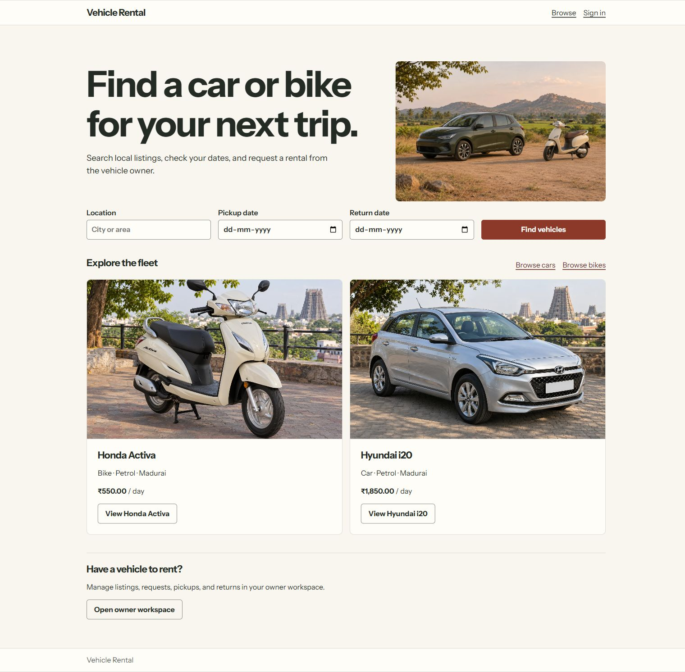
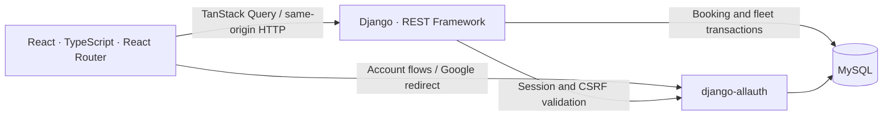

# Vehicle Rental Marketplace

Browse cars and bikes, request a rental for selected dates, and follow the
booking through pickup and return. Vehicle owners manage their fleet,
availability, incoming requests, maintenance, and completed booking value.



## Architecture



Vite builds the React application. Django serves the SPA under `/app/` and
the root redirects there. The SPA, API, and account endpoints share the same
origin. The browser uses Django's HttpOnly session cookie and passes a CSRF
token for unsafe requests. Google returns through django-allauth's provider
callback. Django Admin remains available under `/admin/`.

Django calculates inclusive-day quotes and validates final availability on
submission. MySQL row locks serialize conflicting reservations and concurrent
listing-cap checks. A pending request holds its dates for up to 24 hours.
Vehicle archiving preserves booking history.

## Run locally

Requires Python 3.11, Node 22.12+, and MySQL 8.4. Docker can provide MySQL.

1. Copy `.env.example` to `.env`. Set a unique `DJANGO_SECRET_KEY`, choose a local
   `MYSQL_PASSWORD`, and set `DJANGO_DEBUG=1`. Use `MYSQL_HOST=127.0.0.1` and a
   free `MYSQL_PORT`.
2. Start MySQL with `docker compose up --wait db`, or create the database and
   application user yourself. The Compose service also grants access to
   Django's test database.
3. Create a Python virtual environment and run
   `python -m pip install -r requirements.txt`.
4. Run `npm --prefix frontend ci` and `npm --prefix frontend run build`.
5. Run `python manage.py migrate` and `python manage.py runserver`.
6. Open [the local marketplace](http://127.0.0.1:8000/).

For frontend development, start Django on port 8000 and run
`npm --prefix frontend run dev`. Open the Vite URL under `/app/`. Vite proxies
the API and account routes to Django. Use the same-origin built app to test
Google callbacks and email links.

## Docker

With the local environment configured, run:

```sh
docker compose --profile app build web
docker compose up --wait db
docker compose --profile app run --rm web python manage.py migrate
docker compose --profile app up -d web
```

The web image builds React, collects static files, and serves Django through
Gunicorn. For production, set `DJANGO_DEBUG=0`, supply secrets through the
runtime environment, set `DJANGO_ALLOWED_HOSTS`, and place the app behind HTTPS.
Enable `DJANGO_TRUST_HTTPS_PROXY=1` only when your proxy overwrites
`X-Forwarded-Proto`. Serve persistent uploaded media from the proxy or a
dedicated media service. Configure SMTP with the `DJANGO_EMAIL_*` settings and
set `DJANGO_FROM_EMAIL`. Local debug mode prints account email to the console.

Google sign-in uses `GOOGLE_CLIENT_ID` and `GOOGLE_CLIENT_SECRET` when
configured. Register the callback at
`/accounts/google/login/callback/` for the exact host, scheme, and port.

## API overview

| Endpoint | Purpose |
| --- | --- |
| `GET /api/v1/session/` | Browser session and CSRF token |
| `GET /api/v1/vehicles/` | Date-aware catalog with filters and pagination |
| `GET /api/v1/vehicles/{id}/` and `/quote/` | Listing details, blocked dates, reviews, and server quote |
| `GET, POST /api/v1/bookings/` | Customer booking history and rental requests |
| `POST /api/v1/bookings/{id}/{action}/` | Cancel, approve, reject, record pickup, or record return |
| `POST /api/v1/bookings/{id}/review/` | Review a completed rental |
| `GET /api/v1/owner/bookings/` and `/owner/value/` | Owner rental queue and completed booking totals |
| `GET, POST /api/v1/owner/fleet/` | Owner listings and multipart creation |
| `PATCH, DELETE /api/v1/owner/fleet/{id}/` | Update, publish, unpublish, or archive a listing |
| `/api/v1/owner/fleet/{id}/maintenance/` | List or create maintenance blocks, with deletion by block ID |
| `/auth/browser/v1/` | django-allauth browser authentication and account APIs |

## Demo and tests

Set `RENTAL_DEMO_PASSWORD` to a disposable password of at least 12 characters
with `DJANGO_DEBUG=1`, then run `python manage.py seed_demo`. For Docker, use
`docker compose --profile app run --rm -e RENTAL_DEMO_PASSWORD web python manage.py seed_demo`
with the password exported in your shell.

The demo creates `renter@rental-demo.example`, `owner@rental-demo.example`,
and two listings in Madurai. Sign in as the renter and request a vehicle for
today. Sign in as the owner to approve it and record pickup and return.
Return to the renter account to download the summary and leave a review.

Run `python manage.py test`, `npm --prefix frontend test`,
`npm --prefix frontend run lint`, and `npm --prefix frontend run build`.
CI runs the Django suite on MySQL and checks the TypeScript application.

[Catalog](docs/screenshots/catalog.jpg) · [Booking details](docs/screenshots/booking.jpg) · [Owner workspace](docs/screenshots/owner.jpg) · [Demo photo credits](rental/demo_images/CREDITS.md)

## License

Application code is [MIT licensed](LICENSE). Demo photographs use their
respective licenses.
